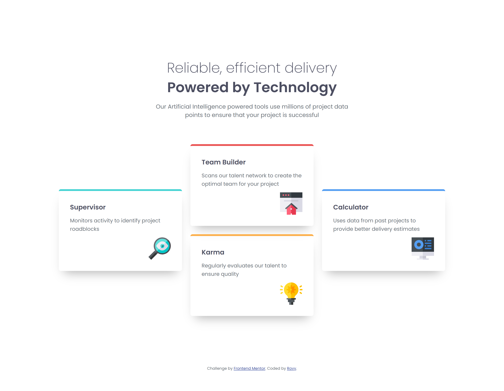

# Frontend Mentor - Four card feature section solution

This is a solution to the [Four card feature section challenge on Frontend Mentor](https://www.frontendmentor.io/challenges/four-card-feature-section-weK1eFYK). Frontend Mentor challenges help you improve your coding skills by building realistic projects. 

## Table of contents

- [Overview](#overview)
  - [The challenge](#the-challenge)
  - [Screenshot](#screenshot)
  - [Links](#links)
- [My process](#my-process)
  - [Built with](#built-with)
  - [What I learned](#what-i-learned)
  - [Continued development](#continued-development)
  - [Useful resources](#useful-resources)
  - [AI Collaboration](#ai-collaboration)
- [Author](#author)

## Overview

### The challenge

Users should be able to:

- View the optimal layout for the site depending on their device's screen size

### Screenshot

### Links

- Solution URL: [Github repository](https://github.com/rovyhonolario53-code/four-card-feature-section-frontend-mentor)
- Live Site URL: [Github pages](https://rovyhonolario53-code.github.io/four-card-feature-section-frontend-mentor/)

## My process

### Built with

- Semantic HTML5 markup
- CSS custom properties
- Flexbox
- CSS Grid
- Mobile-first workflow
- SCSS

### What I learned

In this project, I learned the real importance of using @mixins for almost every element. I thought it shouldn't matter since technically its already the same with the design. But those little details is what matters the most in responsive web development.

### Continued development

- Keep using semantic HTML tags like the <ul> for the list of cards.
- Consistent and responsive values (em, rem).
- Rely on eyeballing instead of asking for estimates in AI

### Useful resources

- [Sass documentation](https://sass-lang.com/documentation/) - Helped me understand variables, nesting, and mixins.
- [Google Fonts](https://fonts.google.com/) - Where I got the embed code for Poppins.

### AI Collaboration

**Claude**

Used for asking the estimates of sizes as well remind me of things I have missed. 

## Author

- Frontend Mentor - [@Rovy Rain](https://www.frontendmentor.io/profile/rovyhonolario53-code)
- Github - [@rovyhonolario53-code](https://github.com/rovyhonolario53-code)

